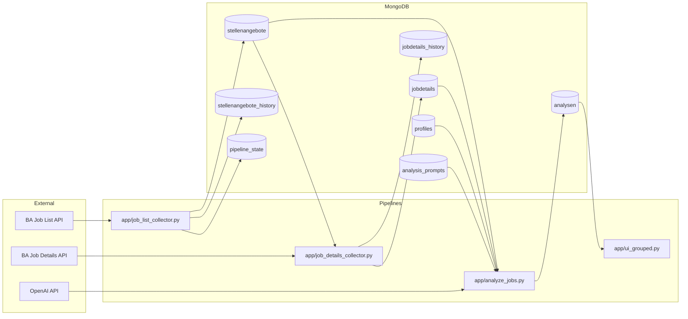

# System Overview

## Purpose

The system collects job meta, enriches job details, analyzes vacancies with LLM, and exposes grouped results in Streamlit.

## Decomposition Entry Points

This page keeps the legacy high-level overview, but the “general scheme” is now split into focused maps to reduce visual noise and line crossings.

Read in this order:

1. [35 System Context Map](35-system-context-map.md)
What it shows: L0 contours only (major blocks and integrations).

2. [36 Data Lifecycle Map](36-data-lifecycle-map.md)
What it shows: lifecycle of vacancy/profile/search artifacts and storage flow.

3. [37 Runtime Request Flow](37-runtime-request-flow.md)
What it shows: request-time path from query to ranked top-N output.

4. [38 Taxonomy Governance Flow](38-taxonomy-governance-flow.md)
What it shows: taxonomy/synonyms extraction, review, freeze, and runtime loader usage.

Why keep this page:
- fast legacy orientation in one diagram;
- backward-compatible links for existing docs;
- handoff reference while teams migrate to 35 -> 36 -> 37 -> 38.

## Component Map

## Module Responsibility

- `job_list_collector`: idempotent upsert of vacancy meta, list presence events, and guarded active/inactive transitions. Missing-mark is applied only after a full scan and only when list query scope (`query_hash`) is unchanged vs previous run.
- `job_details_collector`: early date-based prefilter, API verification only for candidates, hash-based update and history.
- `analyze_jobs`: joins current meta+details, computes `input_hash`, skips unchanged inputs by `(referenznummer, candidate_profile_key, input_hash)`, and writes profile-scoped versioned documents.
- `ui_grouped`: read-only grouped presentation of analysis results.
