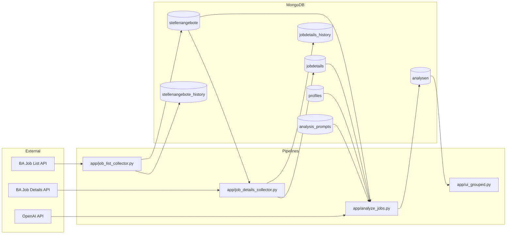

# System Overview

## Purpose

The system collects job meta, enriches job details, analyzes vacancies with LLM, and exposes grouped results in Streamlit.

## Component Map

## Module Responsibility

- `job_list_collector`: idempotent upsert of vacancy meta, list presence events, active/inactive state transitions.
- `job_details_collector`: early date-based prefilter, API verification only for candidates, hash-based update and history.
- `analyze_jobs`: joins current meta+details, computes `input_hash`, skips unchanged inputs, versioned writes to `analysen`.
- `ui_grouped`: read-only grouped presentation of analysis results.
