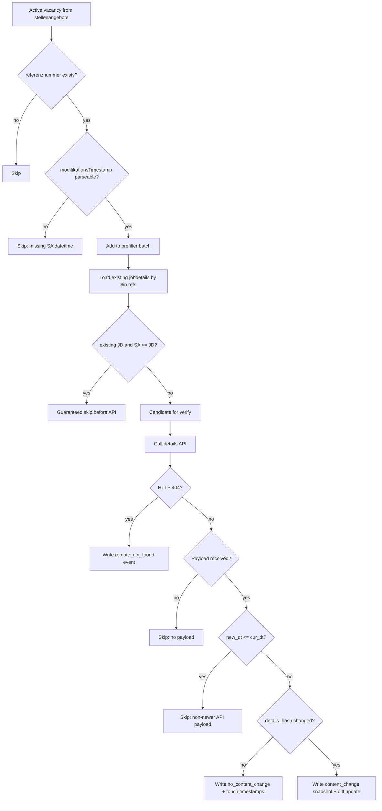
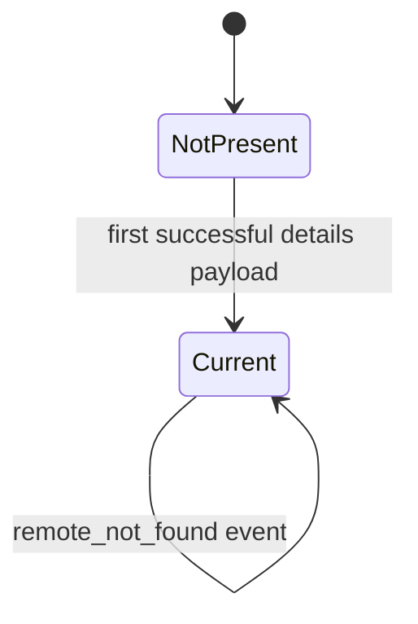

# Job Details: Decision Flow and States

## Decision Flow (`job_details_collector`)

## State Diagram (per vacancy details)

## Why this matters

- Expensive checks are executed only for uncertain candidates.
- API load is controlled by date gate and prefilter.
- History events preserve explainability of skipped/updated decisions.
