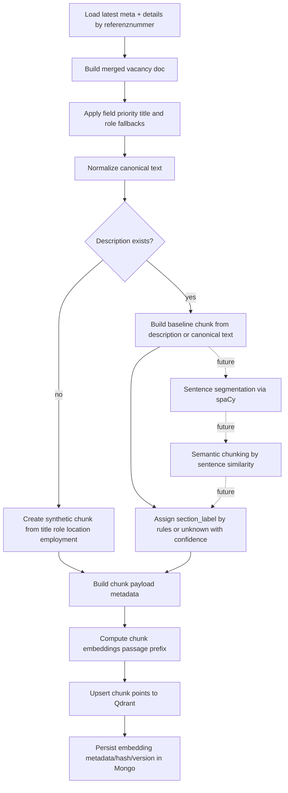

# Embedding/Chunking Flow Diagram

## Purpose

Shows how merged vacancy data is transformed into chunks and vectors.

Current implementation status:
- Baseline chunking is implemented (single robust chunk per vacancy).
- `spaCy + semantic chunking` is planned as next phase.

