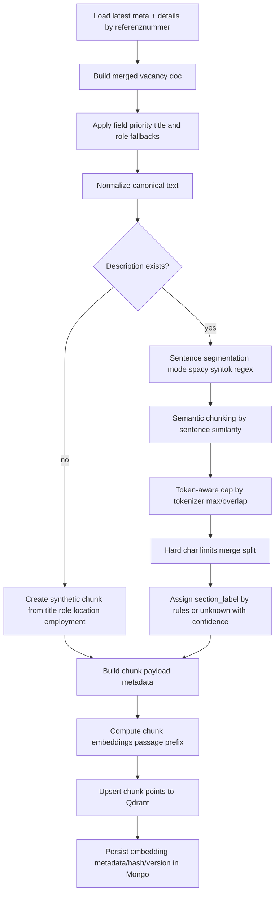

# Embedding/Chunking Flow Diagram

## Purpose

Shows how merged vacancy data is transformed into chunks and vectors.

Current implementation status:
- `spaCy + semantic chunking` is implemented.
- `syntok` and `regex` sentence split fallback modes are supported.
- token-aware chunk cap is enabled before hard char limits.

