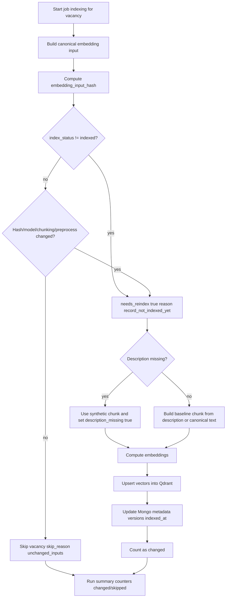

# Embedding Reindex Decision Diagram

## Purpose

Shows strict decision rules for `skip` vs `reindex`, including:
- catch-up reindex for records that are not yet truly indexed in Qdrant;
- missing-description fallback.

