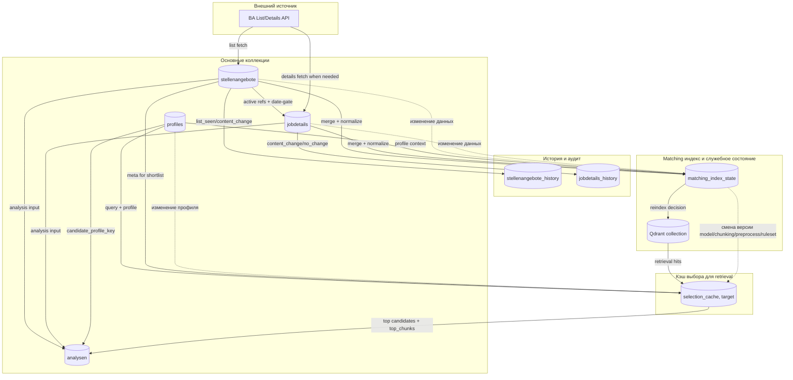
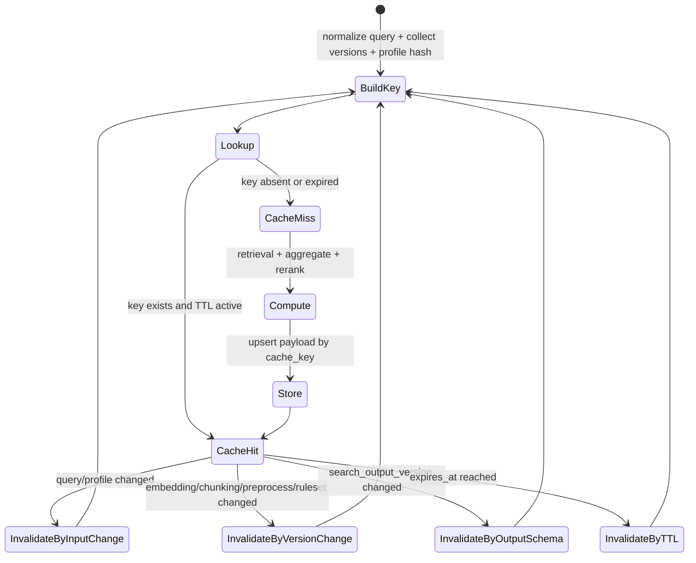

# Кэширование, индексы и инвалидация: общий обзор (RU)

## Назначение

Показать на одной схеме:
- какие кэш/индекс-контуры есть в проекте;
- какие данные они сохраняют;
- какие события вызывают инвалидацию;
- как это влияет на следующий запуск пайплайнов и retrieval.

Важно:
- блок `selection cache` для retrieval сейчас описан как целевой слой (планируемый runtime reuse);
- остальные контуры (history, versioning, matching index state) уже используются в проекте.

## Общая схема (контуры проекта)

## Что считается инвалидацией по доменам

1. `stellenangebote/jobdetails`:
- новое значение значимых полей (фактический content change);
- изменение активности вакансии;
- изменение дат/состояний, влияющих на date-gate и merge.

2. `matching_index_state` / Qdrant:
- `embedding_input_hash` изменился;
- изменилась версия `embedding_model`, `chunking_version`, `preprocess_version`;
- текущий `index_status` не `indexed`.

3. `analysen` (версионирование в самой коллекции):
- изменился `input_hash` (meta + details + profile + prompt + model);
- сменился `candidate_profile_key`;
- сменился prompt/model.

4. `selection_cache` (целевой runtime-контур):
- изменился `query` (после нормализации);
- изменился профиль (`profile_hash`/версия);
- изменились `retrieval.top_k`, `rerank.top_n`, `top_chunks_per_job`;
- изменились версии индекса/правил (`embedding/chunking/preprocess/ruleset`);
- сменился `search_output_version`;
- истек TTL.

## Жизненный цикл cache key (целевой для retrieval)

## Какие проблемы решает инвалидация

1. Защита от устаревшего shortlist:
- кэш не отдает старые кандидаты после изменения профиля/запроса.

2. Защита от несоответствия версии индекса:
- после смены модели/чанкинга не используется результат, рассчитанный на старой версии.

3. Контроль качества LLM handoff:
- `top_chunks`, переданные в LLM, соответствуют актуальному retrieval/rerank состоянию.

4. Баланс скорости и корректности:
- одинаковый вход = быстрый `cache hit`;
- значимые изменения = пересчет и новый результат.
