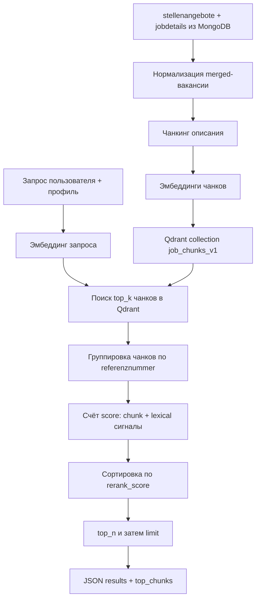
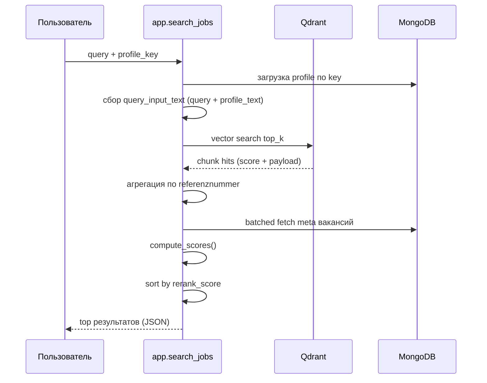

# Matching: как сейчас работает эмбеддинг и выбор вакансий

## Зачем этот документ
Этот файл объясняет текущий фактический runtime-процесс:
1. как строится эмбеддинг-индекс вакансий;
2. как выполняется поиск;
3. как считается итоговый `rerank_score`;
4. почему иногда в топ попадают нерелевантные вакансии.

Документ описывает текущее состояние кода (без желаемых улучшений).

## 1) Общая схема процесса

## 2) Индексация (эмбеддинг-этап)

### Шаги
1. Берутся активные вакансии из `stellenangebote` и соответствующие `jobdetails`.
2. Строится merged-объект вакансии.
3. Текст режется на чанки (текущая стратегия в конфиге — semantic).
4. Для каждого чанка считается embedding.
5. В Qdrant сохраняются точки с payload:
- `referenznummer`
- `chunk_id`
- `chunk_index`
- `section_label`
- `chunk_text`

### Что важно
- В Qdrant хранятся именно векторы чанков, а не “вектор вакансии целиком”.
- При повторном прогоне используется инкрементальная логика (`reindexed/skipped`).

## 3) Поиск и ранжирование (runtime)

## 4) Как считаются score сейчас

### 4.1 `chunk_score` (семантический сигнал)
Берутся top-3 chunk score из Qdrant по вакансии и агрегируются:
- `chunk_top1=0.6`
- `chunk_top2=0.3`
- `chunk_top3=0.1`

Это сигнал из embedding-distance (Qdrant cosine similarity).

### 4.2 Лексические сигналы (без эмбеддинга)
Используется Jaccard-пересечение токенов:
- `role_score = max(Jaccard(query,title), Jaccard(query,role))`
- `profile_score = Jaccard(query,profile_text)`
- `metadata_score = Jaccard(query,location_text)`

### 4.3 `pre_llm_score`
Текущая формула:

`pre_llm = 0.4*role + 0.3*chunk + 0.2*profile + 0.1*metadata`

### 4.4 `rerank_score`
Текущая формула:

`rerank = 0.75*pre_llm + 0.25*lexical_boost(top_chunk_text)`

Если `role_score < role_mismatch_threshold (0.08)`, применяется штраф:

`rerank = rerank * role_mismatch_penalty (0.65)`

## 5) Реальный пример из текущего прогона

Запрос:
- `Frontend Entwickler React TypeScript`

Наблюдение в результате:
- в топе оказалась вакансия `Reinigungskraft (m/w/d) ...`
- `role_score = 0.0`
- `profile_score = 0.0`
- `metadata_score = 0.0`
- но `chunk_score` ненулевой, и этого хватило для попадания в финальный список.

Почему так происходит:
1. Чанк вакансии может быть “семантически близок” по общим словам/шаблонам текста.
2. Лексический `role_score` нулевой, но это не hard-filter.
3. Штраф за role mismatch снижает score, но не исключает вакансию полностью.

## 6) Что именно делает эмбеддинг, а что нет

Эмбеддингом:
- retrieval top_k чанков из Qdrant;
- формирование `chunk_score`.

Не эмбеддингом (лексика):
- `role_score`, `profile_score`, `metadata_score`;
- `lexical_boost(top_chunk_text)`;
- штраф role mismatch.

## 7) Как читать результат JSON

В каждом элементе `results[]`:
- `chunk_score`: сигнал близости из Qdrant;
- `role_score/profile_score/metadata_score`: лексические сигналы;
- `pre_llm_score`: смешанный baseline score;
- `rerank_score`: итог после lexical boost и penalty;
- `top_chunks`: фрагменты текста, которые “протащили” вакансию в выдачу.

Если в `top_chunks` часто видны хвосты типа “подайте заявку / контакт / WhatsApp”, это признак, что retrieval ловит шум, и rerank его недостаточно гасит.

