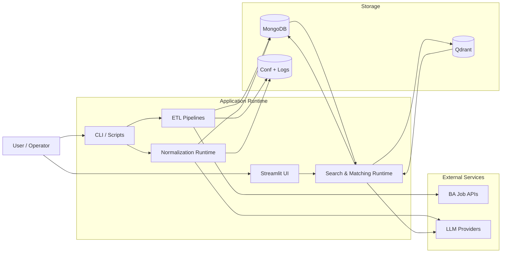

# 35 System Context Map

Тип документа: `current`

## Purpose

L0-карта: только крупные контуры системы и их связи.

## Read Next

1. [36 Data Lifecycle Map](36-data-lifecycle-map.md)
2. [37 Runtime Request Flow](37-runtime-request-flow.md)
3. [38 Taxonomy Governance Flow](38-taxonomy-governance-flow.md)
