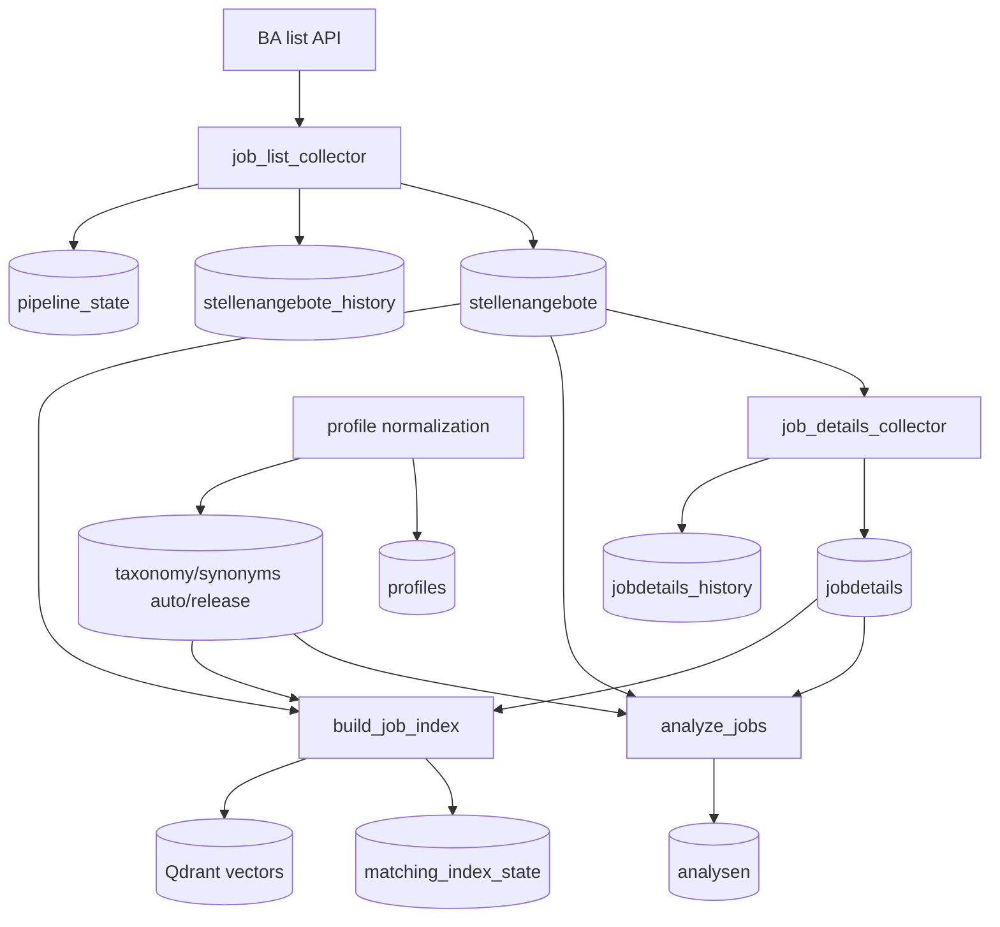

# 36 Data Lifecycle Map

Тип документа: `current`

## Purpose

L1-карта жизненного цикла данных: вакансии, детали, анализ, индексация, нормализационные артефакты.

## Key Invariant

- Источники данных и runtime должны оставаться идемпотентными.
- Изменения в lifecycle синхронизируются с [00 Runtime Contract](00-runtime-contract.md).
