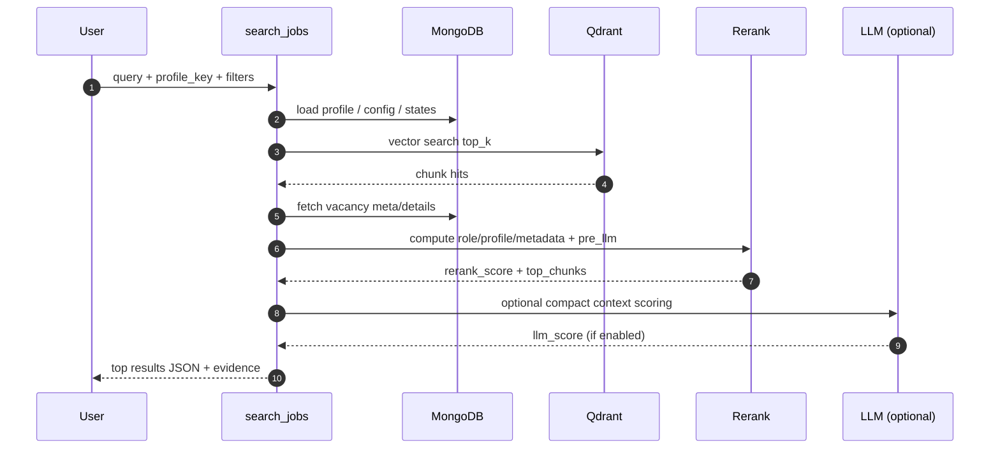

# 37 Runtime Request Flow

Тип документа: `current`

## Purpose

L1 runtime-поток одного поиска: от входного запроса до финального top-N и объясняющих полей.

## See Also

- [23 Retrieval + Rerank Runtime Flow](23-retrieval-rerank-runtime-flow.md)
- [24 Cache + LLM Handoff Explained](24-cache-llm-handoff-explained-ru.md)
- [25 Cache/Index Invalidation Overview](25-cache-index-invalidation-overview-ru.md)
