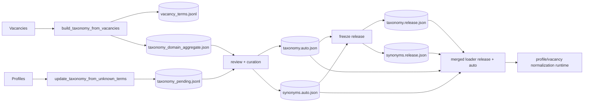

# 38 Taxonomy Governance Flow

Тип документа: `planned/current hybrid`

## Purpose

L1-карта управления словарями taxonomy/synonyms: набор, review, freeze, runtime-использование.

## Operational Rules

- Release режим: learning флаги выключены по умолчанию.
- Dev режим: допускается наполнение `*.auto.json` с review.
- Перед релизом обязателен freeze и детерминизм-check.
