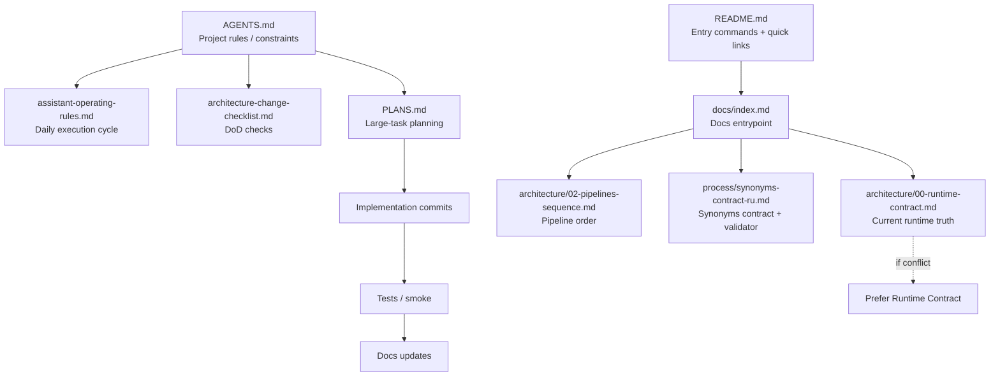

# Диаграмма 01: Source of Truth Map

Audience: `Human + AI`  
Source of truth: `Yes` (навигационная карта приоритетов документации)

Примечание: узлы `AGENTS.md`, `README.md`, `PLANS.md` относятся к файлам вне `docs/`, поэтому в диаграмме не сделаны кликабельными (в strict-режиме это ломает сборку).

## Правило обновления
- Если меняется приоритет документа или “кто источник истины” по теме:
  - обновить эту диаграмму в том же PR/коммите.
