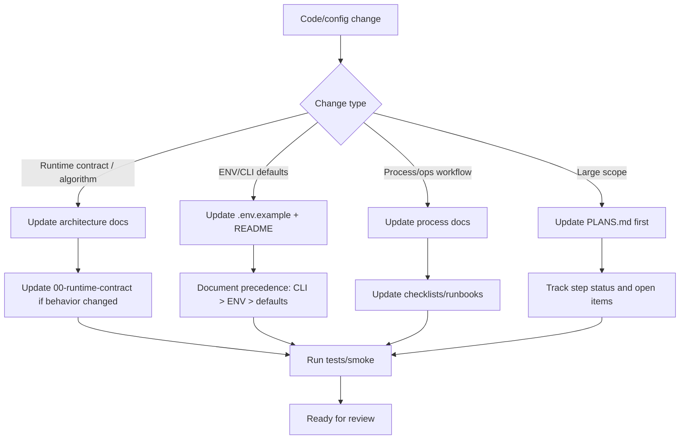

# Диаграмма 02: Doc Change Impact Flow

Audience: `Human + AI`  
Source of truth: `Yes` (какие документы и проверки обновлять при изменениях)

Примечание: шаги про `.env.example`, `README.md`, `PLANS.md` остаются текстовыми в диаграмме, так как это файлы вне каталога `docs/`.

## Правило обновления
- При добавлении нового типа изменений или нового обязательного артефакта:
  - добавить ветку в flow и соответствующий check.
