# Диаграмма 03: Taxonomy/Synonyms Artifact Lifecycle

Audience: `Human + AI`  
Source of truth: `Yes` (жизненный цикл артефактов нормализации)

```mermaid
flowchart LR
    V[(Vacancies)] --> E[build_taxonomy_from_vacancies.py]
    E --> VT[vacancy_terms.jsonl]
    E --> TA[taxonomy_domain_aggregate.json]

    P[(Profiles)] --> U[update_taxonomy_from_unknown_terms.py]
    U --> UT[unknown_terms.jsonl]
    U --> TP[taxonomy_pending.jsonl]

    TA --> S1[LLM synonyms clustering\nplanned]
    S1 --> SP[synonyms.pending.jsonl]
    SP --> RV[review/apply]
    RV --> SA[synonyms.auto.json]

    TP --> RVT[review_taxonomy_pending.py]
    RVT --> TAuto[taxonomy.auto.json]

    TAuto --> FRZ[freeze_taxonomy_release.sh]
    SA --> FRZ
    FRZ --> TR[taxonomy.release.json]
    FRZ --> SR[synonyms.release.json]

    TR --> RUN[Runtime loader\nrelease + auto]
    SR --> RUN
    TAuto --> RUN
    SA --> RUN

    click E "/process/taxonomy-pipeline-decomposition-ru/" "Открыть декомпозицию taxonomy pipeline"
    click U "/process/taxonomy-pipeline-decomposition-ru/" "Открыть декомпозицию taxonomy pipeline"
    click RVT "/process/taxonomy-release-freeze-workflow-ru/" "Открыть release/freeze workflow"
    click FRZ "/process/taxonomy-release-freeze-workflow-ru/" "Открыть workflow freeze"
    click RUN "/architecture/00-runtime-contract/" "Открыть runtime contract"
    click S1 "/process/synonyms-contract-ru/" "Открыть контракт синонимов"
```

## Правило обновления
- Если добавляется новый артефакт (`*.json`, `*.jsonl`) или новый шаг review/freeze:
  - обновить диаграмму и указать владельца шага в текстовом документе рядом.
