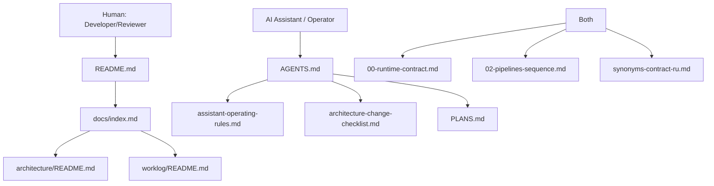

# Диаграмма 04: Audience Entry Points Map

Audience: `Human + AI`  
Source of truth: `Yes` (карта входов для разных ролей)

Примечание: узлы `README.md`, `AGENTS.md`, `PLANS.md` отражают файлы за пределами `docs/`, поэтому как ссылки в диаграмме не заданы.

## Правило обновления
- Если меняется “первый документ для роли” или добавляется новая роль:
  - обновить карту и секцию Audience Map в `README.md`/`docs/index.md`.
