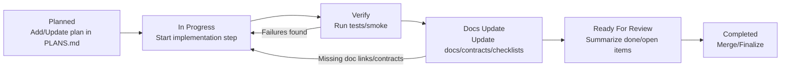

# Диаграмма 05: Plan Lifecycle and Gates

Audience: `Human + AI`  
Source of truth: `Yes` (обязательные gate-этапы для крупных изменений)

Примечание: этап `Planned` ссылается на `PLANS.md` (файл вне `docs/`), поэтому в диаграмме оставлен без клика.

## Правило обновления
- Если добавляется новый обязательный gate (например новый quality gate):
  - добавить его в lifecycle и в checklist (`architecture-change-checklist.md`).
