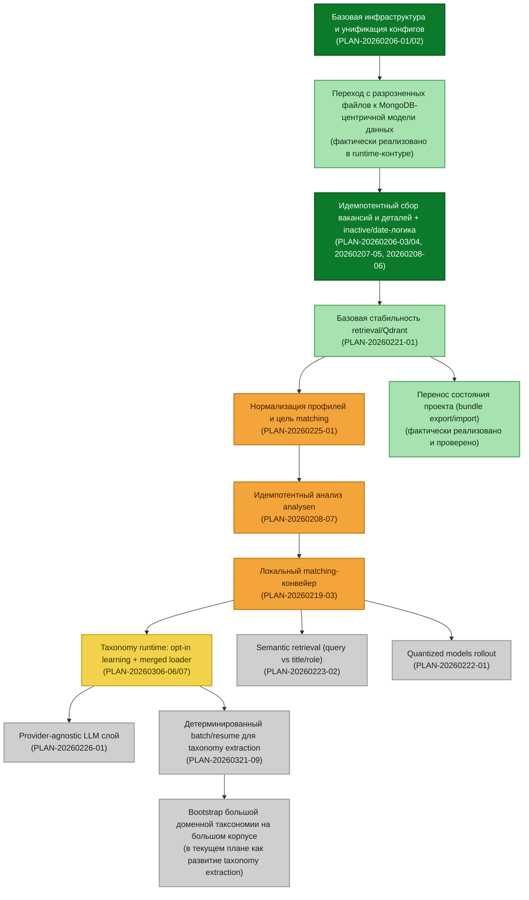

# Фактическое состояние проекта и этапы развития (текущий срез)

Документ фиксирует **только реальное состояние** проекта на текущий момент:
- что уже сделано и как это работает;
- что сделано частично;
- что запланировано дальше по текущему плану (`PLANS.md`).

Документ не добавляет гипотетические этапы и не заменяет детальные техпланы в `PLANS.md`.

---

## 1) Схема текущего состояния этапов



### Легенда цветов
- Насыщенный зелёный: хорошо завершено.
- Светло-зелёный: в целом завершено, возможны небольшие доработки.
- Жёлтый: требует небольшой доработки.
- Оранжевый: требует значительной доработки.
- Серый: ещё не начато, но уже входит в текущий план.

---

## 2) Что уже сделано и как это функционирует сейчас

Ниже формат: **проблема → как решено → конкретный пример**.

### 2.1 Базовая инфраструктура и единый конфиг
**Проблема:** разнородные точки настройки усложняют запуск и сопровождение.  
**Решение:** стандартизирован конфиг в `conf/`, основной файл `conf/app.json`, ENV-override по правилам проекта.  
**Пример:**
- Runtime модули работают через единый контур:
  - `app/job_list_collector.py`
  - `app/job_details_collector.py`
  - `app/analyze_jobs.py`
- Базовый запуск:
```bash
.venv/bin/python -m app.job_list_collector
.venv/bin/python -m app.job_details_collector
.venv/bin/python -m app.analyze_jobs
```

### 2.2 Переход от файлового подхода к MongoDB-центричной модели
**Проблема:** хранить основной state по множеству файлов неудобно для идемпотентности, версионирования и повторных прогонов.  
**Решение:** основной state процесса хранится в MongoDB-коллекциях (`stellenangebote`, `jobdetails`, `analysen`, `profiles` и служебные коллекции истории/индексов).  
**Пример:**
- В проекте зафиксированы и используются коллекции:
  - `stellenangebote`
  - `jobdetails`
  - `analysen`
  - `profiles`
- Для ускорения и стабильности обработок добавлены индексы и date-поля (этапы `PLAN-20260208-06`, `PLAN-20260208-07`).

### 2.3 Идемпотентный сбор вакансий и деталей
**Проблема:** повторные прогоны могут перегружать источники и создавать лишнюю работу.  
**Решение:** реализованы идемпотентные пайплайны списка/деталей и защитная логика inactive/list_seen/date-фильтров.  
**Пример:**
- Перед запросами деталей используется дата-фильтр (сравнение `modifikationsTimestamp` и `aenderungsdatum`), чтобы не делать лишние вызовы.
- Повторный запуск коллектора не должен без причины переписывать те же документы.

### 2.4 Базовая стабильность retrieval/Qdrant
**Проблема:** поиск и ранжирование без устойчивого векторного слоя нестабильны и плохо масштабируются.  
**Решение:** включён рабочий контур Qdrant + индексация и поиск.  
**Пример:**
```bash
.venv/bin/python -m app.bootstrap_qdrant
.venv/bin/python -m app.search_jobs --query "Data Engineer Python" --profile-key default --limit 20
```

### 2.5 Перенос состояния проекта между машинами (export/import bundle)
**Проблема:** перенос проекта вручную часто ломается (пропуски `.env`, Mongo dump, Qdrant storage, логов).  
**Решение:** реализованы штатные скрипты:
- `tools/export_project_state_bundle.sh`
- `tools/import_project_state_bundle.sh`

**Как работает сейчас:**
1. Экспорт собирает единый архив состояния (`.env`, `conf/`, `logs/normalization`, Mongo archive, Qdrant snapshot).
2. Импорт умеет восстановить это состояние с явными флагами replace/reset.
3. Добавлены path resolver'ы через `docker inspect`:
   - `tools/lib/state_bundle_paths.sh`
   - цепочка: override -> docker inspect -> fallback.

**Конкретный пример рабочего цикла:**
```bash
bash tools/export_project_state_bundle.sh --mongo-db jobcenter

bash tools/import_project_state_bundle.sh \
  --bundle backups/transfer/project_state_YYYYMMDDTHHMMSSZ.tar.gz \
  --overwrite-env \
  --restore-mongo-replace \
  --replace-qdrant \
  --replace-conf \
  --replace-logs
```

### 2.6 Закрытые практические проблемы в import
**Проблема 1:** `Authentication failed` при `mongorestore` сразу после `docker compose up`.  
**Решение:** добавлено ожидание готовности Mongo перед restore (`wait_for_mongo_ready`).

**Проблема 2:** `Permission denied` при очистке `mongo_data/qdrant_data` (root-owned файлы).  
**Решение:** безопасная очистка каталога с fallback через `docker run` от root внутри контейнера (`clear_dir_contents`).

**Проблема 3:** некорректная распаковка Qdrant snapshot в нестандартный target path.  
**Решение:** распаковка snapshot в контейнере прямо в целевой каталог.

---

## 3) Что выполнено частично (реально в работе)

### 3.1 Нормализация профилей и цель matching (`PLAN-20260225-01`)
**Статус:** в работе.  
**Что есть:** базовые инструменты нормализации профиля и процессные скрипты.  
**Что не закрыто полностью:** доведение до финального устойчивого качества в production-контуре.

### 3.2 Идемпотентный анализ `analysen` (`PLAN-20260208-07`)
**Статус:** в работе.  
**Что есть:** версия/хеш-входа и подход к пропуску лишнего.  
**Что осталось:** окончательно закрыть все edge-case сценарии в связке с полным контуром.

### 3.3 Локальный matching-конвейер (`PLAN-20260219-03`)
**Статус:** в работе.  
**Что есть:** базовый контур, retrieval+search+matching.  
**Что осталось:** доведение до целевого end-to-end качества и устойчивости.

### 3.4 Taxonomy runtime: флаги learning + merged loader (`PLAN-20260306-06/07`)
**Статус:** в работе/частично закрыто.  
**Что есть:** opt-in механика learning и merged слой taxonomy/synonyms.  
**Что осталось:** привести в полностью завершённое состояние по плану и закрепить как стабильный runtime-стандарт.

---

## 4) Что фактически запланировано дальше (не начато)

Ниже: **проблема + предполагаемое решение + на каком этапе**.

### 4.1 Нестабильность сравнимости прогонов taxonomy extraction
**Проблема:** без детерминированного батча сравнение моделей и resume могут дрейфовать.  
**Предполагаемое решение:** детерминированная сортировка выборки + устойчивый checkpoint/resume + консистентный финальный aggregate.  
**Этап:** `PLAN-20260321-09` (запланирован).

### 4.2 Единый провайдерный слой для локальных и внешних LLM
**Проблема:** разный runtime-путь для провайдеров усложняет поддержку и переключение моделей.  
**Предполагаемое решение:** provider-agnostic слой через общий контракт вызова и конфигурации.  
**Этап:** `PLAN-20260226-01` (запланирован).

### 4.3 Усиление семантического retrieval
**Проблема:** базовый retrieval не всегда оптимально сопоставляет запрос с ролью/заголовком вакансии.  
**Предполагаемое решение:** отдельный приоритетный этап semantic retrieval (`query vs title/role`).  
**Этап:** `PLAN-20260223-02` (запланирован).

### 4.4 Quantized rollout
**Проблема:** нужен контролируемый rollout квантованных моделей после стабилизации базового контура.  
**Предполагаемое решение:** отдельный post-pipeline rollout с метриками и операционными проверками.  
**Этап:** `PLAN-20260222-01` (запланирован).

### 4.5 Bootstrap большой доменной таксономии (текущая рабочая стратегия)
**Проблема:** ждать долгого онлайн-дообогащения словаря на старте рискованно для качества.  
**Предполагаемое решение:** заранее прогнать большой корпус вакансий, извлечь термины, собрать доменно-ориентированную базовую таксономию с синонимами как стартовый артефакт.  
**Этап:** в логике текущего плана это развитие блока taxonomy extraction и deterministic batch (`PLAN-20260321-09`) с использованием существующего инструментария:
- `tools/build_taxonomy_from_vacancies.py`
- `tools/run_taxonomy_benchmark.sh`

---

## 5) Минимум, который нужен сейчас для рабочего сквозного процесса

Чтобы система стабильно работала в текущем приоритете (MVP + bootstrap база), реально нужно довести:

1. Полный путь:
   - загрузка вакансий;
   - загрузка профилей;
   - нормализация вакансий и профилей;
   - эмбеддинги;
   - поиск/отбор;
   - генерация письма;
   - короткая аналитика.
2. Устойчивость на больших объёмах:
   - checkpoint/resume;
   - retries/timeouts;
   - идемпотентность и детерминированные батчи.
3. Базовый поставляемый словарь:
   - большой стартовый taxonomy/synonyms артефакт;
   - дальнейшее обогащение уже итеративно, после запуска рабочего контура.

---

## 6) Ссылки на ключевые точки реализации

- Runtime:
  - `app/job_list_collector.py`
  - `app/job_details_collector.py`
  - `app/analyze_jobs.py`
  - `app/search_jobs.py`
- Taxonomy/normalization инструменты:
  - `tools/build_taxonomy_from_vacancies.py`
  - `tools/taxonomy_extract.py`
  - `tools/update_taxonomy_from_unknown_terms.py`
  - `tools/review_taxonomy_pending.py`
- Перенос состояния:
  - `tools/export_project_state_bundle.sh`
  - `tools/import_project_state_bundle.sh`
  - `tools/lib/state_bundle_paths.sh`
- Операционные документы:
  - `docs/operations/project-state-transfer.md`
  - `docs/operations/mongo-backup-restore.md`

